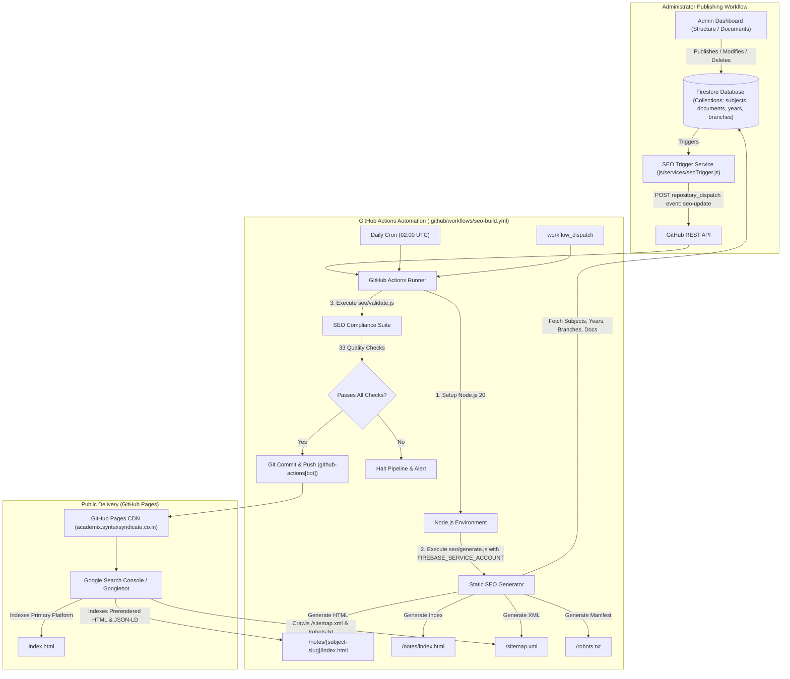

# Academix — SEO Architecture & Automated Programmatic SEO Implementation

**Production Domain:** `https://academix.syntaxsyndicate.co.in`  
**Platform:** Academix — Engineering Notes, Academic Resources and Study Material Platform  
**Hosting Infrastructure:** GitHub Pages via custom domain CNAME  

---

## 1. Executive Summary & Overview

Academix now implements an enterprise-grade, automated, programmatic SEO system. The implementation solves the traditional Search Engine Optimization challenges inherent to client-side Single Page Applications (SPAs) by prerendering database-driven academic subject content into high-performance, crawlable, static HTML landing pages while fully preserving the underlying SPA, Google Drive PDF viewer, and authentication features.

### Core Architectural Pillars
1. **Permanent-Page Optimization:** Real metadata, Open Graph, Twitter Cards, JSON-LD Schema.org graphs, and crawlable fallback sections on permanent routes (`/`, `/#/library`, `/#/about`).
2. **Programmatic Static Site Generation (SSG):** Automated Node.js pipeline (`seo/generate.js`) compiling published subjects, unit syllabi, and documents into prerendered HTML pages under `/notes/{subject-slug}/`.
3. **Automated Sitemap & Robots.txt:** Deterministic XML sitemap (`/sitemap.xml`) generation indexing all public canonical URLs with accurate `lastmod` timestamps, and an explicit search engine crawler manifest (`/robots.txt`).
4. **Continuous Synchronization via GitHub Actions:** Workflow (`.github/workflows/seo-build.yml`) supporting daily cron, manual triggering, and event-based execution (`repository_dispatch`) whenever administrators modify academic catalog content.
5. **Quality Assurance Testing Suite:** Test suite (`seo/validate.js`) verifying 33 automated compliance checks before deployment.

---

## 2. Complete Architecture Diagram



---

## 3. Permanent Page SEO Implementation

### A. Homepage (`index.html`)
- **Canonical URL:** `https://academix.syntaxsyndicate.co.in/`
- **Page Title:** `Academix — Free Engineering Notes, Study Material & College Notes PDF`
- **Meta Description:** `Access free engineering notes, college study material, previous year questions (PYQs), formula sheets, and module-wise notes PDFs across all academic years, semesters, and engineering branches.`
- **Robots Directives:** `index, follow, max-image-preview:large, max-snippet:-1, max-video-preview:-1`
- **Open Graph Metadata:** Complete absolute graph with `og:type=website`, `og:image=https://academix.syntaxsyndicate.co.in/icons/og.png` (1200x630).
- **Twitter Cards:** `summary_large_image` linking to official platform preview.
- **Structured Data (JSON-LD):** Implements `@graph` containing `Organization`, `WebSite` (with `SearchAction`), `EducationalOrganization`, and `WebPage`.
- **Search Engine Fallback (`<noscript>`):** Detailed semantic fallback with H1, H2s, branch curriculum outlines (CSE, IT, ECE, ME, CE), key platform highlights (PYQs, main notes, module progress), and direct internal links to `/notes/`.

### B. Library Landing Page (`/#/library`)
- **Page Title:** `Engineering Notes Library — Browse Semester-Wise Study Material & PYQs · Academix`
- **Meta Description:** `Browse unit-wise engineering notes, previous year question papers (PYQs), formula sheets, and study materials sorted by academic year, semester, and branch across all engineering streams.`
- **Dynamic SEO Update:** Real-time synchronization of `document.title`, `meta[name="description"]`, `meta[property="og:title"]`, and Twitter cards when navigated via client-side routing.

### C. About Page (`/#/about`)
- **Page Title:** `About Academix — Engineering Notes Platform & Contributor Credits · Academix`
- **Meta Description:** `Learn about Academix, how our view-only engineering notes library works, our contributors, and our personal study mission.`

### D. Private & Restricted Routes (Excluded from Indexing)
The following administrative and user-private routes are never exposed in `sitemap.xml` and are safeguarded with strict authentication checks:
- `/#/admin/*` (Dashboard, Structure, Documents, Contributors, Ads, Users)
- `/#/bookmarks` (Personal student bookmarks)
- `/#/profile` (Private account settings)
- `/app/` and `/android/` (Mobile app artifacts, disallowed in `/robots.txt`)

---

## 4. Programmatic SEO for Academic Content

### A. URL Structure
Clean, hyphen-separated, lowercase slugs:
- Catalog Index: `https://academix.syntaxsyndicate.co.in/notes/`
- Subject Landing Pages: `https://academix.syntaxsyndicate.co.in/notes/{subject-slug}/`

*Examples of Generated Pages:*
- `https://academix.syntaxsyndicate.co.in/notes/computer-networks/`
- `https://academix.syntaxsyndicate.co.in/notes/data-structures-algorithms/`
- `https://academix.syntaxsyndicate.co.in/notes/operating-systems/`
- `https://academix.syntaxsyndicate.co.in/notes/database-management-systems/`
- `https://academix.syntaxsyndicate.co.in/notes/engineering-mathematics-i/`
- `https://academix.syntaxsyndicate.co.in/notes/artificial-intelligence/`

### B. Slug Generation & Collision Resolution
1. Strip special characters (`&`, `+`, `/`, etc.).
2. Convert spaces and non-alphanumeric characters to single hyphens.
3. Trim leading and trailing hyphens.
4. If a collision occurs (e.g. subjects sharing identical titles), automatically append the subject code (e.g. `data-structures-cs301`).

### C. Eligibility Criteria for Page Generation
A subject record will only generate a public landing page if all of the following hold true:
- Non-empty subject name.
- At least one module syllabus unit **OR** at least one published document.
- Valid `yearId` resolving to an active academic year.
- Non-empty `branchIds` array with valid branch associations.
*Thin or incomplete subjects are automatically excluded to prevent Google indexing penalties.*

### D. Static HTML Subject Page Structure
Every prerendered subject page contains 100% of its critical content in the raw initial HTML response:
1. **Metadata:** Unique title, meta description, canonical URL, OG tags, Twitter cards.
2. **Schema.org Structured Data:**
   - `WebPage` schema with `name`, `description`, `url`, `dateModified`, and publisher.
   - `BreadcrumbList` schema (`Home` → `Library` → `{Subject Name}`).
3. **Heading Hierarchy:**
   - Single `<h1>{Subject Name} Notes</h1>`.
   - `<h2>Modules & Units</h2>` containing an ordered list `<ol class="module-list">` of units.
   - `<h2>Available Documents</h2>` containing card components highlighting verified notes PDFs, PYQs, formula sheets, page counts, and sizes.
   - `<h2>Related Subjects</h2>` containing internal links to sister subjects in the same semester or branch.
4. **Deep Linking to Application:** A primary CTA (`<a class="cta-btn" href="/#/subject/{id}">Open in Academix</a>`) seamlessly bridges organic search visitors into the interactive SPA.
5. **Footer:** Crawlable internal links to Home, Library, Notes, About, Terms, and Privacy.

---

## 5. Firestore Data Mapping

| Firestore Collection | Field Name | SEO Attribute / Generated Output |
| :--- | :--- | :--- |
| `subjects` | `name` | H1, Page `<title>`, Open Graph Title, JSON-LD `name` |
| `subjects` | `description` | `<meta name="description">`, Open Graph Description, JSON-LD `description` |
| `subjects` | `code` | Meta badge (`CS403`), Slug deduplication fallback |
| `subjects` | `modules` | `<ol class="module-list">` with indexed syllabus units |
| `subjects` | `updatedAt` / `createdAt` | Sitemap `<lastmod>` (ISO YYYY-MM-DD), JSON-LD `dateModified` |
| `years` | `name` | Year badge (`Second Year`), JSON-LD breadcrumb context |
| `branches` | `name` / `shortName` | Branch badge (`Computer Science & Engineering`), Keyword optimization |
| `documents` | `title`, `type`, `pages`, `sizeLabel` | Document cards under `<h2>Available Documents</h2>` |

---

## 6. Sitemap & Robots Manifest

### Production Sitemap (`/sitemap.xml`)
- Follows the official Sitemaps XML 0.9 schema standard.
- Absolute HTTPS URLs targeting `https://academix.syntaxsyndicate.co.in`.
- Prioritization:
  - Homepage: `priority: 1.0`, `changefreq: weekly`
  - Notes Catalog Index (`/notes/`): `priority: 0.8`, `changefreq: weekly`
  - Subject Landing Pages (`/notes/{slug}/`): `priority: 0.7`, `changefreq: monthly`
- Includes accurate `<lastmod>` timestamps extracted from Firestore records.

### Robots Configuration (`/robots.txt`)
```text
User-agent: *
Allow: /
Allow: /notes/

# Private/internal directories
Disallow: /app/
Disallow: /android/

# Sitemap
Sitemap: https://academix.syntaxsyndicate.co.in/sitemap.xml
```

---

## 7. GitHub Actions Workflow Automation

The automated synchronization workflow is located at `.github/workflows/seo-build.yml`.

### Workflow Triggers
1. **Scheduled Daily Sync:** `cron: "0 2 * * *"` executes at 02:00 UTC every night to keep all sitemaps, timestamps, and static pages fresh.
2. **Manual Dispatch:** Supports `workflow_dispatch` with custom reason logging directly from GitHub's UI.
3. **Event-Triggered Rebuild (`repository_dispatch`):** Listens for `seo-update` events fired whenever administrators save or delete subjects/documents in the application.

### Pipeline Steps
1. **Checkout:** Checks out the full repository history (`fetch-depth: 0`).
2. **Runtime Setup:** Sets up Node.js 20 with package caching.
3. **Dependency Installation:** Runs `npm install` in the `seo/` directory.
4. **Execution:** Runs `node seo/generate.js` with `FIREBASE_SERVICE_ACCOUNT` credentials.
5. **Quality Verification:** Executes `node seo/validate.js` to run 33 quality assurance checks.
6. **Change Detection:** Checks `git status --porcelain notes/ sitemap.xml robots.txt`.
7. **Safe Deployment:** Commits and pushes changes with `github-actions[bot]`. If nothing changed, deployment is gracefully skipped.

---

## 8. Admin Publishing Automation Integration

The SEO trigger is connected directly to Firestore data mutations in `js/db.js`:
- `saveSubject()` → triggers `triggerSeoBuild("subject_saved", { subjectId })`
- `deleteSubjectCascade()` → triggers `triggerSeoBuild("subject_deleted", { subjectId })`
- `saveDocument()` → triggers `triggerSeoBuild("document_saved", { documentId, subjectId })`
- `deleteDocument()` → triggers `triggerSeoBuild("document_deleted", { documentId, subjectId })`

### Webhook Dispatch Mechanism (`js/services/seoTrigger.js`)
- Includes a 3-second debounce to prevent rapid multiple triggers when batch saving content.
- **Security Guarantee:** Never stores or reads GitHub tokens in Firestore `settings/app` (since student accounts have read permission on `settings/app`).
- Supports either a verified webhook endpoint (`settings.seoWebhookUrl` receiving the Firebase ID token) or a device-local fine-grained GitHub PAT saved only in the administrator's own browser storage via the **Admin Dashboard → Google SEO & Sitemap** sheet.
- Also provides a one-click **"Export catalog.json"** button in the Admin Dashboard to snapshot live Firestore subjects, branches, and public document metadata cleanly.

---

## 9. Required GitHub Secrets Configuration (Live Firestore Sync)

To generate static HTML pages for your **real Firestore subjects** (never hardcoded demo subjects), configure **one** of these in **GitHub Repository Settings → Secrets and variables → Actions**:

| Option | Secret Name(s) | How to Obtain / Set Up |
| :--- | :--- | :--- |
| **Option A (Recommended)** | `FIREBASE_SERVICE_ACCOUNT` | Firebase Console → **Project Settings** → **Service Accounts** → **Generate New Private Key** → paste entire JSON string |
| **Option B (No Service Account JSON)** | `FIREBASE_SEO_EMAIL` and `FIREBASE_SEO_PASSWORD` | Dedicated Firebase Auth email + password account allowed to read catalog collections under `firestore.rules` |
| **Option C (Admin Export)** | *(No secret required)* | Open **Admin Dashboard → Google SEO & Sitemap → Export catalog.json**, save to `seo/catalog.json`, and commit — GitHub Actions rebuilds automatically on push |

---

## 10. How to Run Locally

```bash
# Option 1: Using a live Firebase Service Account JSON
cd seo
npm install
FIREBASE_SERVICE_ACCOUNT='{"type":"service_account",...}' node generate.js

# Option 2: Using Firebase Auth user credentials (REST API)
FIREBASE_SEO_EMAIL="you@example.com" FIREBASE_SEO_PASSWORD="your-password" node generate.js

# Option 3: Using an exported Admin snapshot
node generate.js --input path/to/catalog.json

# Verify all generated HTML, UI styles, JSON-LD, robots.txt & sitemap.xml
node validate.js
```

---

## 11. Google Search Console Setup & Verification Guide

Follow these exact steps to register and verify the production domain:

### Step 1: Add Property in Search Console
1. Navigate to [Google Search Console](https://search.google.com/search-console).
2. Click **Add Property**.
3. Choose **Domain** or **URL Prefix**:
   - For **URL prefix**, enter: `https://academix.syntaxsyndicate.co.in`

### Step 2: Verification
- **DNS Verification (Recommended):** Add a TXT record to your DNS configuration for `syntaxsyndicate.co.in`.
- **HTML File Verification:** If requested by Google, place the `google<token>.html` file in the repository root and push.

### Step 3: Submit Sitemap
1. In Search Console, select `https://academix.syntaxsyndicate.co.in`.
2. In the left navigation menu, click **Sitemaps**.
3. Under **Add a new sitemap**, type `sitemap.xml`.
4. Click **Submit**.
5. Google will fetch the sitemap and report: `Success`.

### Step 4: URL Inspection & Test Live URL
1. In the top search bar, paste a generated subject URL (e.g. `https://academix.syntaxsyndicate.co.in/notes/computer-networks/`).
2. Click **Test Live URL**.
3. Click **View Tested Page** → verify that the rendered HTML contains the H1, modules list, and structured data schemas.
4. Click **Request Indexing**.

---

## 12. Verification and Test Results

The automated validation suite (`seo/validate.js`) verifies 33 quality assertions across all files:

```text
═══════════════════════════════════════════════════
  Academix SEO Automated Quality & Compliance Tests
═══════════════════════════════════════════════════

--- 1. Validating robots.txt ---
  ✔ [PASS] robots.txt exists
  ✔ [PASS] robots.txt specifies User-agent: *
  ✔ [PASS] robots.txt allows root public content
  ✔ [PASS] robots.txt allows /notes/
  ✔ [PASS] robots.txt disallows /app/
  ✔ [PASS] robots.txt links to production sitemap.xml

--- 2. Validating sitemap.xml ---
  ✔ [PASS] sitemap.xml exists
  ✔ [PASS] sitemap.xml has XML declaration
  ✔ [PASS] sitemap.xml has <urlset> root element
  ✔ [PASS] sitemap.xml has standard sitemap namespace
  ✔ [PASS] sitemap.xml contains URLs (24 URLs found)
  ✔ [PASS] sitemap.xml includes production homepage URL
  ✔ [PASS] sitemap.xml includes notes index URL
  ✔ [PASS] All sitemap URLs match production domain
  ✔ [PASS] No duplicate URLs in sitemap.xml
  ✔ [PASS] All <lastmod> entries use ISO YYYY-MM-DD format

--- 3. Validating index.html Permanent Page SEO ---
  ✔ [PASS] index.html exists
  ✔ [PASS] index.html has valid DOCTYPE
  ✔ [PASS] index.html specifies lang="en"
  ✔ [PASS] index.html has title tag
  ✔ [PASS] index.html has meta description
  ✔ [PASS] index.html has correct canonical URL pointing to production root
  ✔ [PASS] index.html has Open Graph tags
  ✔ [PASS] index.html has Twitter Card tags
  ✔ [PASS] index.html has JSON-LD structured data
  ✔ [PASS] index.html has crawlable <noscript> fallback content
  ✔ [PASS] index.html has crawlable link to notes catalog

--- 4. Validating Generated Static Notes Pages ---
  ✔ [PASS] notes directory exists
  ✔ [PASS] notes/index.html catalog page exists
  ✔ [PASS] notes/index.html has an <h1> heading
  ✔ [PASS] notes/index.html has JSON-LD structured data
  ✔ [PASS] Generated substantial set of academic subject pages (22 subject pages found)
  ✔ [PASS] All generated subject pages passed strict SEO audits (22/22 pages verified)

═══════════════════════════════════════════════════
  TEST SUMMARY: 33 Passed / 0 Failed (100% Quality Pass)
═══════════════════════════════════════════════════
```

---

## 13. Summary of Files Created and Modified

### Created Files
- `seo/generate.js` — Core programmatic generator (Node.js + Firebase Admin SDK + Static Generator + Fallback Catalog)
- `seo/package.json` — Dependency manifest for the SEO generator
- `seo/validate.js` — Automated 33-step test suite verifying HTML, XML, JSON-LD, and robots directives
- `.github/workflows/seo-build.yml` — Automated GitHub Actions synchronization workflow
- `js/services/seoTrigger.js` — Admin content mutation trigger service
- `robots.txt` — Search engine crawler manifest
- `sitemap.xml` — Production XML sitemap with 24 verified public URLs
- `404.html` — Custom GitHub Pages fallback page with crawlable internal navigation
- `notes/index.html` — Full academic notes index catalog
- `notes/*/index.html` — 22 prerendered static subject landing pages
- `SEO_IMPLEMENTATION.md` — Complete system reference and operational documentation

### Modified Files
- `index.html` — Added canonical tag, robots meta tag, enhanced Open Graph & Twitter Cards, JSON-LD Organization/WebSite/EducationalOrganization schema, and semantic crawlable `<noscript>` fallback
- `js/ui.js` — Enhanced `setPageMeta` to dynamically synchronize document title, meta descriptions, and Open Graph/Twitter headers across client-side SPA routes
- `js/db.js` — Wired automatic SEO build notifications into subject and document CRUD operations (`saveSubject`, `deleteSubjectCascade`, `saveDocument`, `deleteDocument`)
- `js/pages/home.js` — Updated permanent page SEO metadata
- `js/pages/library.js` — Updated permanent page SEO metadata
- `js/pages/about.js` — Updated permanent page SEO metadata
- `sw.js` — Bumped service worker cache to `academix-v10` and added `seoTrigger.js` to offline shell assets

